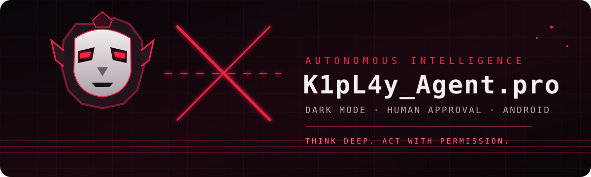

# K1pL4y_Agent.pro

<p align="center">
  
</p>

<p align="center">
  <strong>Asisten AI Android eksperimental · Bahasa Indonesia · Fokus pada kontrol pengguna</strong>
</p>

<p align="center">
  <a href="https://github.com/jambudio336-hue/KiplayCllaw/actions"></a>
  <a href="https://github.com/jambudio336-hue/KiplayCllaw/releases"></a>
  
</p>

> **Peringatan status:** proyek ini masih eksperimental. Build yang berhasil bukan bukti bebas bug, audit keamanan, atau jaminan kompatibilitas semua perangkat. APK yang tersedia dari workflow saat ini ditandatangani dengan debug key dan hanya untuk pengujian.

## Daftar isi
- [Fitur](#fitur)
- [Unduh dan pasang](#unduh-dan-pasang)
- [Memulai dan memasukkan API key](#memulai-dan-memasukkan-api-key)
- [Memori dan percakapan](#memori-dan-percakapan)
- [Otomasi Android dan Termux](#otomasi-android-dan-termux)
- [Keamanan dan privasi](#keamanan-dan-privasi)
- [Build dari source](#build-dari-source)
- [Struktur repo](#struktur-repo)
- [Batasan yang diketahui](#batasan-yang-diketahui)
- [Lisensi](#lisensi)

## Fitur

| Modul | Keterangan | Batasan |
|---|---|---|
| Chat AI | Chat dengan provider yang dikonfigurasi di aplikasi | Perlu API key dan internet untuk provider cloud |
| Provider AI | Anthropic Claude, OpenAI, Google Gemini, dan OpenRouter jika didukung versi aplikasi | Harga dan akses model mengikuti provider; nama model bisa berubah |
| API key | Disimpan memakai Android Keystore dan penyimpanan privat aplikasi | Tetap jangan bagikan perangkat yang sudah dibuka kuncinya |
| Memori jangka panjang | Menyimpan fakta/proyek/preferensi lokal; bisa dicari atau dikelola melalui alat memori dengan persetujuan | Bukan memori sempurna; fakta sensitif jangan disimpan |
| Riwayat chat | Percakapan baru dan membuka riwayat yang disimpan | Hapus chat tidak otomatis menghapus fakta di memori terpisah |
| Peningkatan berbasis hasil | Jurnal kategori hasil tool membantu menghindari pengulangan langkah yang gagal | Tidak melatih ulang model dan tidak menulis ulang source code secara mandiri |
| Input dan output suara | Input suara serta text-to-speech jika diaktifkan dan tersedia pada perangkat | Membutuhkan izin mikrofon/pengaturan suara |
| Skill | Coding full-stack, riset, review kode, respons insiden, pentest berizin, analisis pasar | Skill adalah panduan; bukan bukti tool/data real-time tersedia |
| Kontrol Android | Sebagian aksi UI melalui Accessibility Service dan tool perangkat | Hanya setelah izin pengguna; tidak semua aplikasi mengizinkan otomasi |
| Termux | Menjalankan perintah melalui integrasi Termux yang kompatibel | Periksa perintah sebelum menyetujui; jangan jalankan perintah asing |
| Layanan latar belakang | Service dengan notifikasi persisten untuk tugas yang diaktifkan pengguna | Android/OEM dapat membatasi proses; pengguna tetap bisa menghentikannya |
| Tema | Identitas gelap hitam-merah dan ikon robot bertopeng | Animasi video pertarungan anime belum termasuk dalam build ini |

### Analisis pasar dan keamanan
Skill dapat membantu menganalisis forex, saham Indonesia/global, indeks, emas/perak, minyak, crypto, spot/futures, serta berita makroekonomi. Aplikasi tidak menjamin feed harga otomatis: harga, chart, kalender ekonomi, dan berita hanya real-time jika sumber data benar-benar terhubung. Jika tidak ada sumber, agen harus menyatakan keterbatasannya, bukan mengarang angka.

Gunakan fungsi keamanan siber hanya pada sistem yang kamu miliki atau yang ada izin tertulisnya. Untuk trading live, perlakukan jawaban AI sebagai analisis; sebelum tindakan finansial, cek instrumen, arah, ukuran posisi, leverage, entry, stop-loss, take-profit, dan risiko secara mandiri. Tidak ada jaminan profit.

## Unduh dan pasang

1. Buka [GitHub Releases](https://github.com/jambudio336-hue/KiplayCllaw/releases).
2. Pilih rilis terbaru yang bertanda **Test Build**.
3. Unduh `app-release.apk`.
4. Buka file pada Android dan izinkan pemasangan dari sumber tersebut jika Android meminta.
5. Setelah selesai, buka aplikasi dan lanjutkan ke Pengaturan.

**Penting:** APK uji saat ini ditandatangani dengan debug key. APK ini bukan rilis produksi dan belum boleh dipakai sebagai distribusi Play Store. Untuk build produksi dibutuhkan signing key yang dikelola pemilik aplikasi dan disimpan sebagai secret, bukan di repo.

## Memulai dan memasukkan API key

1. Buka aplikasi **K1pL4y_Agent.pro**.
2. Buka ikon **Pengaturan** di bar atas.
3. Di bagian **Penyedia AI**, pilih provider yang ingin dipakai.
4. Di bagian provider yang dipilih, masukkan API key dari dashboard resmi provider tersebut.
5. Tekan **Simpan**. Setelah status menunjukkan kunci tersimpan, pilih provider itu sebagai provider aktif.
6. Pastikan nama model yang dipilih tersedia pada akun dan endpoint provider.
7. Kembali ke chat dan kirim pertanyaan sederhana untuk menguji koneksi.

### Mendapatkan API key
- **Anthropic:** buat key melalui dashboard resmi Anthropic.
- **OpenAI:** buat key melalui platform resmi OpenAI.
- **Google Gemini:** buat key melalui Google AI Studio.
- **OpenRouter:** buat key melalui dashboard resmi OpenRouter.

Buat key hanya pada situs resmi provider. Pemakaian API dapat berbayar dan mengikuti limit akun. Jangan memasukkan API key ke chat AI, source code, README, screenshot, issue, atau commit Git. Jika key bocor, cabut/revoke dari dashboard provider dan buat key baru. Aplikasi menyimpan key secara lokal terenkripsi, mengirim key Gemini melalui header HTTP alih-alih query URL, dan menonaktifkan backup data aplikasi. Malware atau orang yang memiliki kendali atas perangkat tetap dapat menimbulkan risiko.

## Memori dan percakapan

- Tekan ikon **Percakapan Baru** untuk mulai chat terpisah.
- Tekan ikon **Riwayat** untuk membuka percakapan sebelumnya.
- Alat `memory.manage` mendukung penyimpanan, pencarian, dan penghapusan fakta dengan persetujuan.
- Memori disimpan di database lokal perangkat. Jangan menyimpan password, OTP, token sesi, data bank, atau rahasia.
- Menghapus riwayat chat tidak otomatis menghapus fakta yang tersimpan di memori. Kelola keduanya secara terpisah.
- Jurnal hasil tool mencatat kategori hasil untuk membantu strategi berikutnya; bukan self-training, bukan self-rewriting, dan tidak menjamin semua detail selalu diingat.

## Otomasi Android dan Termux

### Izin Android
Aktifkan hanya fitur yang benar-benar dibutuhkan:
1. Buka **Pengaturan Android → Aksesibilitas → Aplikasi yang diunduh/layanan terpasang**.
2. Pilih layanan K1pL4y_Agent.pro dan baca keterangannya sebelum mengaktifkan.
3. Untuk fitur terkait notifikasi, overlay, mikrofon, lokasi, kamera, atau layanan latar belakang, ikuti permintaan izin Android masing-masing.
4. Matikan izin yang tidak digunakan dari pengaturan sistem.

Pemasangan aplikasi tidak lagi otomatis mengubah pengaturan Aksesibilitas melalui ADB. Pengguna harus mengaktifkan layanan secara manual. Nama menu dapat berbeda pada tiap merek Android. Jika Android menampilkan **Setelan dibatasi**, jangan mencoba melewati perlindungan secara membabi buta; pastikan APK berasal dari sumber yang kamu percayai dan ikuti prosedur resmi perangkat.

### Termux
- Pasang Termux dari sumber resmi proyek Termux.
- Periksa versi dan pengaturan izin Run Command sesuai dokumentasi Termux yang sedang berlaku.
- Aktifkan integrasi eksternal hanya jika memang diperlukan.
- Baca setiap perintah dan output sebelum menyetujui tindakan. Jangan memberikan persetujuan otomatis untuk skrip yang tidak dipahami.

## Keamanan dan privasi

- Profil izin awal adalah **Hati-hati**: hanya pembacaan dasar yang terdaftar berjalan otomatis; SMS, lokasi, tangkapan layar, pengiriman, perubahan data, dan tool sensitif meminta persetujuan. Profil lain dapat dipilih secara sadar di Pengaturan. Tool yang tidak dikenal, perubahan data, pengiriman pesan, penghapusan, skrip/Termux, dan pengelolaan memori harus meminta persetujuan.
- Persetujuan aplikasi bukan pengganti review manusia. Periksa penerima, konten, target, dan dampak sebelum mengizinkan tindakan.
- Layanan latar belakang harus tampak melalui notifikasi dan tetap bisa dihentikan oleh pengguna atau sistem.
- Jangan menonaktifkan kontrol keamanan Android untuk memaksa fitur bekerja.
- Lihat [SECURITY.md](SECURITY.md) untuk prinsip keamanan dan pelaporan kerentanan.
- Jangan menganggap APK ini sebagai produk yang telah lolos audit independen.

## Build dari source

Persyaratan dasar:
- JDK 17
- Android SDK untuk compileSdk 35
- Gradle Wrapper yang tersedia di repo
- Koneksi internet untuk mengambil dependensi

Build lokal:

```bash
chmod +x ./gradlew
./gradlew testDebugUnitTest
./gradlew lintDebug
./gradlew assembleDebug
./gradlew assembleRelease
```

Di GitHub, buka tab **Actions**, pilih workflow Android APK, lalu unduh artifact setelah semua pemeriksaan berhasil. Workflow harus gagal jika tes gagal; jangan mengabaikan status tes merah.

## Struktur repo

```text
.github/workflows/       CI build, tes, dan rilis APK uji
app/src/main/kotlin/     kode aplikasi Android/Kotlin
app/src/main/res/        ikon, tema, dan resource Android
app/src/main/assets/     skill AI dan aset model lokal
app/src/test/            tes unit
app/src/androidTest/     tes instrumentasi
README.md                panduan proyek
CHANGELOG.md             catatan perubahan
SECURITY.md              prinsip keamanan
LICENSE.md               status lisensi
```

## Batasan yang diketahui

- Build belum merupakan rilis produksi yang ditandatangani dengan kunci privat.
- Fitur provider cloud membutuhkan key, koneksi, kuota, dan model yang masih tersedia.
- Tidak semua operasi perangkat dapat dilakukan pada semua versi Android.
- Video anime pertarungan loop dengan efek suara belum disertakan; penambahan memerlukan aset video/audio yang dibuat sendiri atau memiliki lisensi yang sesuai, serta kontrol audio yang jelas.
- Menjalankan proses terus-menerus tidak dapat dijamin pada Android; OS dapat menghentikan proses demi keamanan, baterai, atau memori.
- Belum ada klaim bahwa seluruh repo bebas bug atau sudah lulus audit keamanan independen.

## Lisensi

Lihat [LICENSE.md](LICENSE.md). Status lisensi upstream perlu dikonfirmasi sebelum distribusi publik atau komersial. Jangan menganggap repo ini memiliki lisensi open-source yang sudah disahkan sampai hal itu dibereskan.
